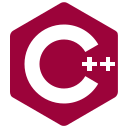
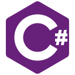
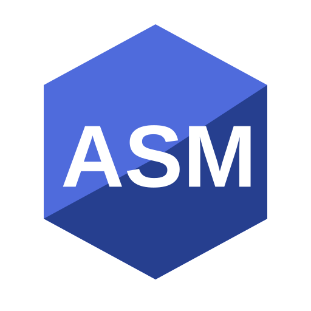
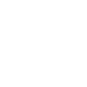
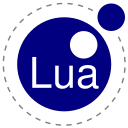
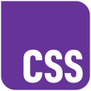
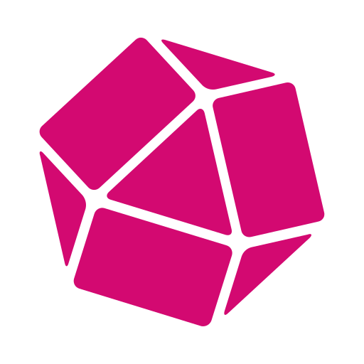

 # Hi there 👋 my name is Filippo Mecozzi 
 ## Software Architect and Developer

<!-- - 🖥️  See my portfolio at [PortafoglioNome](http://portafoglio) -->
- 🌍  I'm based in Italy
- 📫  You can contact me at [codesavant23@proton.me](mailto:codesavant23@proton.me)

_"But it is the spirit in a person, **the breath of the Almighty**,
that gives them understanding."_ - Job 32:8 (NIV)

---

I graduated with a Bachelor's degree in "IoT, Big Data & Web" at the University of Udine, where I focused on Internet of Things, Big Data, and Artificial Intelligence.

I've been passionate about software development since I was a kid (around 7–8 years old), and that passion led me to pursue a technical path in computer science.

Despite being early in my career, I've already have some freelancing professional experiences and had the opportunity to explore a fairly wide range of technologies and programming languages. (both in non-professional and professional fields).

In addition, I have solid foundations in system administration and networking, with hands-on experience in common IoT protocols and paradigms.

## 👨‍🔧 Software Design

A special place in my interests is reserved for **software design**. I naturally tend to approach development from an architectural perspective rather than focusing only on implementation details.

Over the years, I’ve developed a strong understanding of Object-Oriented design principles, including Dependency Injection (with generics), 
and, most of all, **SOLID principles** which I generally prefer over other approaches for their clarity, scalability, and maintainability.

Regardless of my personal preferences, I readily adapt to client demand thanks to my natural curiosity and ability to rapidly learn new IT domains.

## 🤔 *"Hmm... yeah, but looking at your GitHub, there’s not much to go on. It’s pretty bare."*

I completely understand! If I were looking at my profile from the outside, I’d probably think the same thing.

**Here's the full story:**

> **90% of my work is kept private to protect both my clients' and my own intellectual property and data sovereignty.** Rather than using public platforms, I host and manage my code repositories on a private, self-hosted **Forgejo** instance.

My public thesis repo serves merely as an academic "Proof of Concept" to demonstrate my baseline technical skills - it is not reflective of the production-grade quality, testing, or documentation standards I apply in client projects.

💬 **<ins>Want to know me more</ins>, or what I’ve built?** Drop me a message! I'm always happy to walk you through my real-world experience, architectural decisions or tech stack.

## Professional Experiences

### Mobile App in C# / .NET MAUI for image searching (for AI & Field Service Management systems)
_**Proposed Role**_: _.NET MAUI Software Engineer and Developer (Freelance)_

**Cross-Platform Mobile Application Development (C# / .NET MAUI)**

- Design and development from scratch of a native mobile application using C# and .NET MAUI, focused on integration with computer vision and image analysis platforms.
- Managing application architecture to ensure efficient network traffic handling, and a seamless user experience.
- Implementation of client-side integration with the Flickr APIs to enable advanced, extensive searches of image datasets, in support of visual recognition models and enterprise Field Service Management (FSM) systems.

### Reporting & Data Formatting Software (Ophthalmic Sector / QC)
_**Proposed Role**_: _Software Engineer / Data Tooling Consultant (Freelance)_

**Development of Reporting & Data Processing Module (C# / .NET)**

- Design and implementation from scratch of a software module dedicated to the manipulation, formatting, and human-readable visualization of production and quality control data in an industrial/ophthalmic context.
- Engineering data flows from optical inspection systems to transform complex metrics into clear, structured reporting for use by line operators and quality management.

### Windows Background Service for Embedded Systems Monitoring
_**Proposed Role**_: _Middleware Developer (Freelance)_

**Development of a Watchdog & Data Pipeline Windows Service (Embedded Integration)**

- Design and development of a background Windows service (Watchdog) for the continuous monitoring and validation of production data on industrial machines and embedded systems.
- Implementation of parsing, data cleansing, and preliminary structuring logic in accordance with the format specifications required by downstream enterprise systems, ensuring service reliability and high availability.

### High-Performance RASP Library in C++
_**Proposed Role**_: _C++ Software Engineer and Developer / Cybersecurity Consultant (Freelance)_

**Design & Development of the RASP Library (C++ for CyberSecurity)**

- Design and development from scratch of a Runtime Application Self-Protection (RASP) library in native C++, engineered to protect and harden client-side applications and individual software components operating in untrusted environments.
- Management of software architecture and code engineering based on SOLID principles, ensuring modularity and maintainability while prioritizing high computational performance where required.
- Implementation of active, runtime-level security logic designed to prevent tampering, unauthorized use of the software (or single components), and attempts at reverse engineering.
- Proposed the use of a cross-language ABI, through C language, to integrate the library into software systems of different nature

### Flutter/Dart Application for Event/Activity Planning
_**Proposed Role**_: _Mobile Software Engineer and Developer / UI-UX Engineer (Freelance)_

**Cross-Platform Mobile App Development for Time Management (Dart / Flutter)**

- Architecture and development of an advanced mobile application for task and event management, featuring a dynamic and modular filtering engine (with customizable Boolean logic - AND/OR/XOR/NOT - for advanced users).
- Complex management of temporal recurrence (single, recurring, finite, and infinite series) and custom notification/reminder rules.
- User interface design based on a "progressive disclosure" UX model, structured to adapt intuitively to both basic and advanced users.
- Enhancement of usability and practical ease of use through the provision of redundant user paths for specific features.

## Languages and Technologies

Here's a <ins>**non-exhaustive**</ins> list of the technologies and languages i've used/learned:

### 💻 Programming Languages

### 🌐 Web & Markup

### 📊 Data & Statistics (Languages and Libraries)

### 🗄️ Databases

### 🧰 Misc

 

<!--
**codesavant23/codesavant23** is a ✨ _special_ ✨ repository because its `README.md` (this file) appears on your GitHub profile.

Here are some ideas to get you started:

- 🔭 I’m currently working on ...
- 🌱 I’m currently learning ...
- 👯 I’m looking to collaborate on ...
- 🤔 I’m looking for help with ...
- 💬 Ask me about ...
- 📫 How to reach me: ...
- 😄 Pronouns: ...
- ⚡ Fun fact: ...
-->
